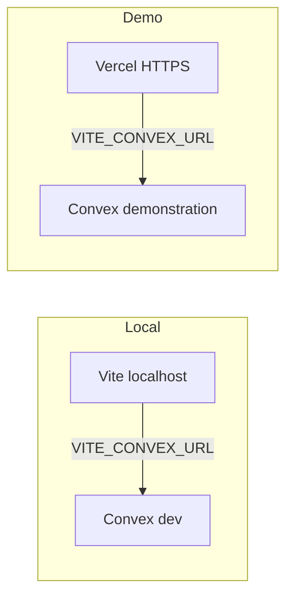
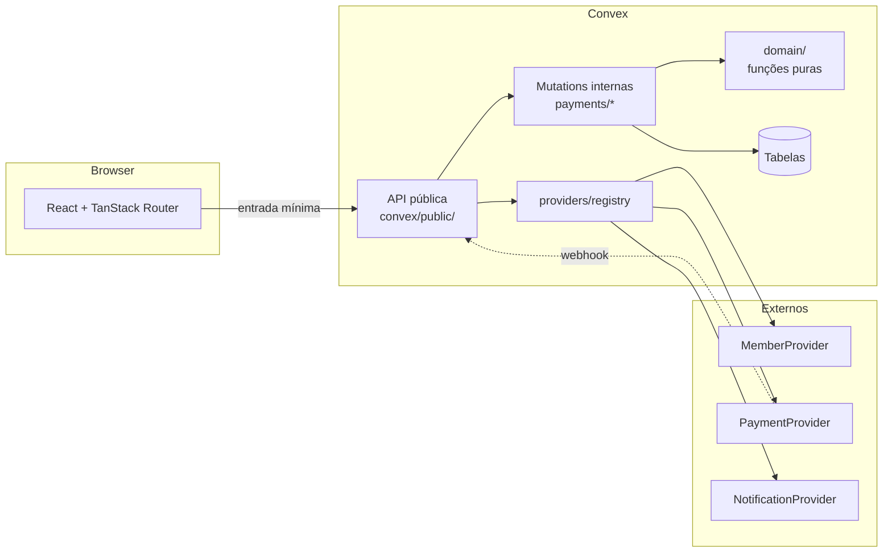
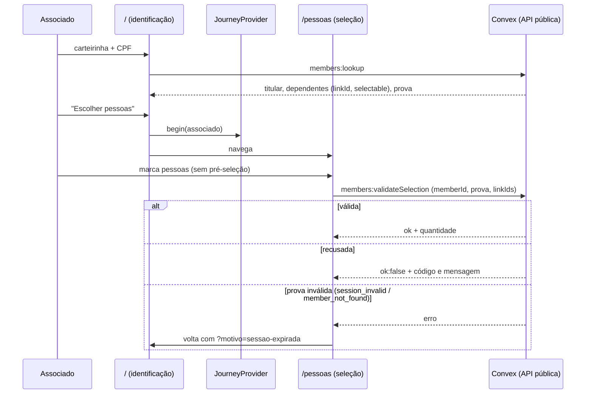
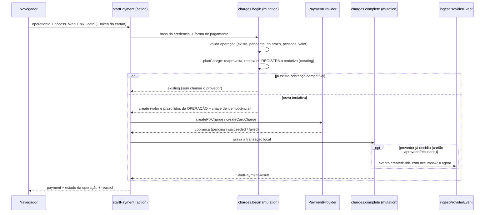

# Arquitetura

Aplicação pública (sem contas de associados) para pagamento da taxa médica das piscinas da sede
campestre: R$ 30,00 por pessoa, via Pix ou cartão, com 15 minutos para concluir.

> Escopo: **não** é um sistema de reservas. Não há agenda, disponibilidade, lotação nem outros
> espaços. Regras em [business-rules.md](./business-rules.md).

## Ambientes (desenvolvimento × demonstração × produção)



| Ambiente        | Hospedagem frontend | Convex                        | `APP_ENV`       | Dados / providers      |
| --------------- | ------------------- | ----------------------------- | --------------- | ---------------------- |
| Desenvolvimento | Vite local          | Deployment de desenvolvimento | `development`   | Fictícios + mocks      |
| Demonstração    | Vercel              | Deployment **separado**       | `demonstration` | Fictícios + mocks      |
| Produção        | Vercel (futuro)     | Deployment de produção        | ≠ mock-allowed  | Reais; mocks recusados |

- O frontend **nunca** embute segredos: só `VITE_CONVEX_URL` (ver `src/lib/env.ts`).
- SPA na Vercel: [`vercel.json`](../vercel.json) reescreve rotas para `index.html` (TanStack Router).
- Guia operacional: [deployment-guide.md](./deployment-guide.md).
- **Não** reutilizar automaticamente o Convex local como backend da URL pública de demo.

## Camadas



| Camada                | Local                                 | Responsabilidade                                                                                                                                                                 |
| --------------------- | ------------------------------------- | -------------------------------------------------------------------------------------------------------------------------------------------------------------------------------- |
| Interface             | `src/`                                | Exibir dados e coletar entradas. Não calcula valores nem decide elegibilidade.                                                                                                   |
| API pública           | `convex/public/`                      | **Única** superfície alcançável pelo navegador (lista fechada em teste). Valida argumentos e identificação; não decide. Ver [API pública](#api-pública-contrato-com-o-frontend). |
| Mutations internas    | `convex/payments/`, `convex/members/` | Consistência e regras que exigem transação: criar operação, expirar, aplicar confirmação, concluir análise.                                                                      |
| Domínio               | `convex/domain/`                      | Funções puras e testáveis: decisão de confirmação, seleção, política de uso, preço, estados, mensagens, CPF.                                                                     |
| Contratos e providers | `convex/providers/`                   | Interfaces, mocks e `registry.ts`.                                                                                                                                               |
| Dados                 | `convex/schema.ts`                    | Ver [data-model.md](./data-model.md).                                                                                                                                            |

**Funções internas por padrão.** Fora de `convex/public/`, tudo é `internal*`: não é alcançável
pelo navegador. As funções públicas são finas: validam a prova de identificação e delegam à
mesma lógica (`createOperationCore`, `resolveMemberSelection`, `findConflicts`) que as versões
internas usam, sem duplicar regras.

**Núcleo puro + execução transacional.** Decisões complexas (ex.: `decideConfirmation`,
`resolveSelection`) são funções puras sem acesso a banco, testadas isoladamente. As mutations
apenas carregam dados, chamam a decisão e a executam de forma atômica.

## Estrutura do backend

```text
convex/
  schema.ts
  domain/
    statuses.ts       enums, validators, máquinas de estado
    pricing.ts        taxa, prazo de 15 min, cálculo de totais
    time.ts           datas de calendário x instantes, fuso America/Sao_Paulo
    usagePolicy.ts    regras de uso configuráveis (data, valor unitário)
    selection.ts      seleção individual por vínculo; duplicidade por personId
    confirmation.ts   decisão sobre notificações de pagamento
    messages.ts       textos exibidos ao associado
    cpf.ts, privacy.ts, idempotency.ts
  public/             ÚNICA superfície pública (guardada por teste)
    members.ts        lookup (action), validateSelection (query)
    payments.ts       checkDuplicates, createOperation, getOperation, startPayment,
                      getReceiptDownloadUrl, requestReceiptEmail,
                      simulateDemoPayment (só APP_ENV=demonstration + mock + accessToken)
  dev/
    simulate.ts       (interna, APP_ENV=development|demonstration + mock) CLI/painel
    mockSimulation.ts núcleo compartilhado (notificação assinada → processProviderNotification)
  security/
    rateLimit.ts      contadores de janela fixa e purga agendada
  members/
    sync.ts           upsert de titular, pessoas (personId) e vínculos
    lookupGate.ts     (interna) limites da consulta, falhas e conclusão (sync + sessão)
    sessions.ts       prova de identificação (emitir, exigir, purgar)
    family.ts         resolveMemberSelection: validação única da seleção por vínculo
  payments/
    operations.ts     createOperationCore, create (interna), expire
    charges.ts        (interna) begin / complete / fail: criação idempotente da cobrança
    chargeView.ts     o que o associado vê de uma cobrança e do estado da operação
    webhookProcessor.ts  processProviderNotification: assinatura → porta única (base do webhook)
    confirmations.ts  applyConfirmation (helper; só chamado por providerEvents)
    providerEvents.ts ingest (porta única de eventos do provedor), resolveAlert
    reviews.ts        resolve (análise administrativa)
    claims.ts         reservas por pessoa/data (duplicidade)
    events.ts         histórico de alterações
    receipts.ts       emissão idempotente e numeração
  providers/          contratos, registry e mock/
tests/                domain/ (puros), convex/ (convex-test) e web/ (interface)
```

## Estrutura do frontend

```text
src/
  routes/                 arquivos de rota (TanStack Router): __root, index (/), pessoas (/pessoas), data (/data), resumo (/resumo), pagamento (/pagamento)
  app/providers/          AppConvexProvider e JourneyProvider (estado da jornada em memória)
  components/layout/      JourneyLayout (faixa azul + folha no mobile; painel dividido no desktop)
  components/ui/          componentes base (button, input, card, alert, text-field…)
  features/identification/  etapa 1: api/ lib/ hooks/ components/
  features/selection/       etapa 2: api/ lib/ hooks/ components/
  features/usage-date/      etapa 3: api/ lib/ hooks/ components/
  features/summary/         etapa 4: api/ lib/ hooks/ components/ (cria a operação)
  features/payment/         etapa 5: tela intermediária (sem cobrança ainda)
  lib/                    cliente Convex, env, withTimeout, readPublicError
```

Cada feature segue o mesmo padrão: `api/` (**única** camada que chama o Convex), `lib/` (funções
puras que interpretam respostas), `hooks/` (estado da tela) e `components/` (apresentação). Os
componentes recebem os dados e as ações por props; não importam o cliente Convex.

**Estado da jornada.** `JourneyProvider` (contexto React) guarda o associado identificado
(incluindo a prova de 30 min), os `linkId` selecionados e a data de utilização (`usageDate`, texto `YYYY-MM-DD`) **apenas em memória**. Nada vai para
`localStorage`, `sessionStorage`, cookie ou URL; recarregar a página recomeça pela identificação.
O único dado na URL é o motivo do retorno (`/?motivo=sessao-expirada` ou
`identificacao-necessaria`), sempre normalizado por `parseReturnReason` (valores desconhecidos
são ignorados) e sem nenhum dado pessoal.

**Fluxo das três primeiras telas:**



**Etapa 3 (`/data`): data de utilização.**

```mermaid
sequenceDiagram
  participant U as Associado
  participant P as /pessoas
  participant D as /data
  participant J as JourneyProvider
  participant C as Convex (API pública)
  P->>D: seleção validada (navega)
  Note over D: guarda: sem associado → /; sem pessoas → /pessoas
  U->>D: escolhe a data (YYYY-MM-DD)
  D->>J: setUsageDate
  D->>D: confere local: vazia / inexistente / passada
  D->>C: payments:checkDuplicates (memberId, prova, linkIds, usageDate)
  alt aceita, sem conflitos
    C-->>D: ok, hasConflicts=false
  else conflito
    C-->>D: ok, conflicts=[{linkId, name}]
    D-->>U: lista só os nomes devolvidos
  else recusa (data passada/inválida, seleção)
    C-->>D: ok=false + código e mensagem
  else prova inválida
    C-->>D: erro session_invalid / member_not_found
    D->>P: volta à identificação (?motivo=sessao-expirada)
  end
  U->>P: "Voltar" (seleção e data preservadas)
  U->>J: muda a seleção → usageDate = null
```

- **Nenhum contrato novo.** A tela reutiliza `public/payments:checkDuplicates`, que já valida a
  data (`usagePolicy.checkUsageDate`), revalida a seleção e informa conflitos. A decisão final é
  repetida em `createOperation`.
- **Data de calendário.** `usageDate` é texto `YYYY-MM-DD` de ponta a ponta (campo nativo →
  estado da jornada → backend). Não há `new Date('YYYY-MM-DD')` (seria meia-noite UTC, ainda
  "ontem" em São Paulo). "Hoje" usa `businessCalendarDate` (a mesma função do backend, fuso
  `America/Sao_Paulo`) e a exibição por extenso é feita em UTC sobre os mesmos números.
- **Invalidação.** `JourneyProvider.setSelectedLinkIds` descarta `usageDate` sempre que a seleção
  muda (inclusive trocar uma pessoa por outra); reenviar a mesma seleção não descarta. O
  resultado da validação vive só na tela e é exibido apenas para a data a que se refere.
- **Regra provisória.** Aceitar qualquer data de hoje em diante é provisório (sem dias de
  funcionamento, horários, antecedência, feriados ou fechamentos, ainda não informados pelo
  sindicato). A tela diz isso explicitamente. Quando houver regras, elas entram na `UsagePolicy`
  do backend, sem mudar este fluxo.
- **Privacidade no conflito.** A tela mostra só `name` das pessoas da própria seleção, como o
  backend devolve. O `linkId` não é exibido e nada indica quem é o dono da operação conflitante.

**Etapa 4 (`/resumo`): resumo e criação da operação.**

O associado revisa data, pessoas e valores de referência e confirma. O front chama
`createOperation` com `requestId`. Em sucesso, guarda a operação (id, token, `expiresAt`, valores
oficiais) só em memória e navega para `/pagamento`. Em resultado desconhecido, **não** gera outro
UUID: "Verificar novamente" reenvia a mesma chave. Duplicidade / seleção inválida / data inválida
orientam a correção sem criar operação. Sessão expirada volta à identificação.

**Etapa 5 (`/pagamento`): checkout Pix/cartão (mock).** Chama `startPayment` e consulta
`getOperation` (polling enquanto pendente). Contador visual usa o `expiresAt` da operação (não
reinicia ao trocar de método). Pix: QR/código demonstrativos. Em `APP_ENV=demonstration`,
`getOperation` devolve `demoSimulationAllowed` e a UI oferece botões que chamam
`simulateDemoPayment` (accessToken + outcome simbólico; nunca status financeiro). Em
development, confirmação via CLI `dev/simulate:simulatePayment`. Cartão: tokens `tok_mock_*`.
Stripe real: ver integrations.md.

**Etapa 6 (`/comprovante`): comprovante e notificações.** Sucesso após `confirmed` (PDF + e-mail
mock); tela de análise para `under_review` / pagamento tardio (sem PDF definitivo). WhatsApp
`not_configured`.

**Regras da interface (a interface não decide regras):**

- `selectable` vem do backend; o front só desabilita o cartão. A elegibilidade, a validade da
  seleção e o valor cobrado são decididos no servidor.
- O resumo (quantidade × R$ 30,00) é **informativo**: usa as funções puras de
  `convex/domain/pricing.ts` (`calculateOperationAmounts`, `POOL_MEDICAL_FEE_CENTS`) e é
  recalculado pelo backend na criação da operação.
- Alterar a seleção chama `reset()` do hook de validação: qualquer resultado anterior (validada,
  recusada, indisponível) é descartado, e uma validação em andamento não é reutilizada.
- Chamadas ao Convex têm limite de 20 s (`withTimeout`): o cliente enfileira chamadas offline, e
  sem o limite a tela ficaria "carregando" indefinidamente. Expirado, vira "indisponível" com
  nova tentativa.
- Mobile: resumo e botão fixos na base (`<md`), com `padding-bottom` de
  `max(0.75rem, env(safe-area-inset-bottom))` e `viewport-fit=cover`; no desktop o resumo é um
  cartão estático. Acessibilidade: cartão = `<label>` com checkbox nativo, resumo em
  `aria-live="polite"`, avisos com `role=status`/`alert` e foco movido para eles.

## Fluxos

### 1. Identificação do associado (`public/members:lookup`)

```mermaid
sequenceDiagram
  participant B as Navegador
  participant F as Action (pública)
  participant M as MemberProvider
  participant D as Banco
  B->>F: carteirinha + CPF
  F->>F: valida formato e dígitos do CPF
  F->>M: lookupMember
  M-->>F: found / member + holder + dependentes (cada um com personId)
  alt não encontrado ou CPF diverge
    F-->>B: identification_failed (mesma resposta; conta como falha da carteirinha)
  else encontrado
    F->>D: sincroniza (people, householdLinks, cpfHash, cpfMasked) e emite prova
    F-->>B: titular, situação, dependentes (individual), prova (só se ativo)
  end
```

O titular e cada dependente são devolvidos como itens separados (cada um é um vínculo, com
`personId` próprio); o titular é opcional. Identidade, vínculo e papel são coisas distintas: ver
[data-model.md](./data-model.md#identidade-vínculo-e-papel).

### 2. Criação da operação

1. O navegador envia **`memberId`, prova de identificação, data e as pessoas escolhidas**
   (`linkIds`). Nunca valores, nomes ou prazos.
2. `public/payments:createOperation` verifica a prova e o limite de criações e chama
   `createOperationCore` (a mesma lógica da mutation interna `create`).
3. Em **uma única transação**, a mutation: valida a data (não passada no calendário de São
   Paulo), carrega titular e vínculos do banco, resolve a seleção (`resolveSelection`),
   **verifica duplicidade** por `personId` e data (global, entre titulares), calcula valores (`UsagePolicy` + `calculateOperationAmounts`), grava operação,
   pessoas e reservas, registra o evento `created` e agenda a expiração.
4. Retorna `operationId` + `accessToken` (só o hash é guardado) + valores calculados.

### 3. Cobrança (`public/payments:startPayment`)



Três passos transacionais separados porque a chamada ao provedor não pode ficar dentro de uma
mutation:

1. **`begin`** (mutation): valida e **registra a tentativa** (`chargeAttempts`) antes de qualquer
   chamada externa. É o ponto de exclusão: leitura e escrita acontecem na mesma transação, então
   duas chamadas simultâneas conflitam e a segunda enxerga a tentativa da primeira.
2. **Chamada ao provedor** (action): valor, descrição e prazo vêm da operação; a chave de
   idempotência é `op_<operationId>_<forma>_<tentativa>`. A resposta é conferida (mesmo valor, id
   não vazio); divergência é tratada como falha e não é registrada como cobrança válida.
3. **`complete`** (mutation): grava a transação (`pending`) e, se o provedor já decidiu, entrega o
   resultado à **mesma porta única** dos webhooks (`ingestProviderEvent`). Assim um cartão aprovado
   é tratado exatamente como um Pix pago: no prazo → `paid`/`confirmed`; fora do prazo →
   `paid_late` + análise; valor divergente → análise.

**Idempotência e concorrência.** Uma única cobrança em aberto por operação:

| Situação                                                                  | Resultado                                                          |
| ------------------------------------------------------------------------- | ------------------------------------------------------------------ |
| Cobrança pendente da mesma forma de pagamento                             | Devolve a mesma (`reused: true`), sem chamar o provedor            |
| Cobrança pendente de outra forma                                          | `payment_method_conflict`                                          |
| Outra chamada criando agora (tentativa `creating` < 60 s)                 | `payment_in_progress` (a tela repete)                              |
| Tentativa `creating` antiga (action interrompida) ou em `error`           | Retoma com a **mesma chave** (o provedor devolve a mesma cobrança) |
| Cobrança anterior recusada/cancelada/expirada                             | Nova tentativa (nova chave), até 3 por operação                    |
| Operação paga, em análise, encerrada, expirada ou com valor inconsistente | Recusa, sem tocar no provedor                                      |

Cartão **recusado** não bloqueia: a operação continua pendente e pode ser tentada de novo dentro do
prazo. Trocar de Pix para cartão exige que o Pix pendente termine (limitação consciente: evitar
dois pagamentos simultâneos; não há cancelamento de cobrança no contrato ainda).

**Verificado em backend Convex local** (HTTP, concorrência real): 20 chamadas simultâneas
(10 Pix + 10 cartão pendente) para a mesma operação resultaram em **uma única cobrança** (um Pix);
4 chamadas tiveram sucesso, todas descrevendo a mesma cobrança, e as outras 16 foram recusadas com
`payment_in_progress` ou `payment_method_conflict`. O `convex-test` **não** reproduz essa
concorrência; os testes automatizados a simulam suspendendo a primeira chamada dentro do provedor.

### 4. Confirmação

Porta única: notificação assinada → `processProviderNotification` → `providerEvents.ingest`
(mesma base da futura rota HTTP Stripe). Gatilhos atuais:

- **CLI/painel:** `dev/simulate:simulatePayment` (`internalAction`; `APP_ENV=development|demonstration` + mock).
- **Demonstração pública:** `public/payments:simulateDemoPayment` (só `APP_ENV=demonstration` +
  mock + `accessToken` da operação; outcomes `approved`/`declined`). O cliente **não** envia
  `financialStatus`/`payment_status`.

```mermaid
sequenceDiagram
    participant P as Provedor / demo UI
    participant H as HTTP futura / simulate / simulateDemoPayment
    participant PP as PaymentProvider
  participant I as providerEvents.ingest
  P->>H: webhook bruto + assinatura (ou outcome simbólico na demo)
  H->>PP: processConfirmation
  PP-->>H: PaymentConfirmation (ou invalid_signature)
  H->>I: provider, eventId, transação, status, valor, occurredAt
  I->>I: registra o evento (providerEvents)
  alt mesmo evento já recebido
    I-->>H: duplicate (não reaplica)
  else cobrança desconhecida
    I-->>H: unknown_transaction (alerta administrativo; nada confirmado)
  else transação nossa
    I->>I: applyConfirmation → decideConfirmation (função pura)
    I-->>H: ignored / transaction_updated / confirmed / under_review
  end
  H->>H: agenda notificações conforme o resultado
```

O registro do evento e o processamento ocorrem na **mesma transação**. Detalhes, tabela de
cenários e tratamento de eventos desconhecidos em
[business-rules.md](./business-rules.md#tratamento-de-pagamentos-e-confirmações).

### 5. Comprovante PDF e notificações

Após `applyConfirmation` → `confirmed`:

1. `issueReceipt` (número único `SC-AAAA-NNNNNN`).
2. Agenda `notifications/outbox:afterConfirmed`.
3. `ensureReceiptPdf` gera PDF (texto puro, sem `"use node"`) no Convex File Storage.
4. Outbox de e-mail (`pending` → `deliverReceiptEmail` → `sent`/`failed`).
5. WhatsApp: registro `not_configured` (sem envio).

`under_review` (pagamento tardio): `afterUnderReview` (e-mail de atualização mock; WhatsApp
`not_configured`); **sem** PDF definitivo. Falha de notificação **nunca** reverte financeiro.

Download: `public/payments:getReceiptDownloadUrl` (URL temporária após validar `accessToken`).

## API pública (contrato com o frontend)

Tudo o que o navegador pode chamar está em `convex/public/`; **nada fora dessa pasta é
alcançável**. Um teste (`tests/domain/publicSurface.test.ts`) varre o código e falha se uma
`query`/`mutation`/`action` aparecer em outro lugar ou se a lista de funções públicas mudar,
forçando revisão de segurança. No frontend: `api.public.members.*` e `api.public.payments.*`.
Valores monetários em **centavos**; instantes em ms UTC; `usageDate` é `YYYY-MM-DD`.

### Modelo de acesso (sem login)

Não há conta nem login. A consulta cadastral (carteirinha + CPF) devolve uma **prova de
identificação** (`session.token`, 30 min; só o hash é guardado em `identificationSessions`). As
demais funções recebem `memberId` **e** a prova, e verificam que ela foi emitida para aquele
titular: um `memberId` sozinho não dá acesso a nada. Cada operação criada tem ainda uma
**credencial própria** (`accessToken`) para acompanhamento; as duas credenciais não se
substituem. As pessoas são identificadas por **`linkId`** (vínculo com o titular), nunca pelo
`personId` global.

> Revisão da decisão 11 (antes: "reautenticar com carteirinha + CPF a cada operação"): reenviar o
> CPF em toda chamada ampliaria sua exposição. A prova de curta duração mantém o espírito (sem
> sessão persistente nem conta) com menos exposição do CPF.

### `public/members:lookup` (action): consulta cadastral

|                |                                                                                                                                                          |
| -------------- | -------------------------------------------------------------------------------------------------------------------------------------------------------- |
| **Argumentos** | `{ membershipNumber: string, cpf: string }`                                                                                                              |
| **Retorno**    | `{ member: { id, membershipNumber, status, cpfMasked }, holder: Person, dependents: Person[], session: { token, expiresAt } \| null, message?: string }` |
| `Person`       | `{ linkId, name, role, status, selectable }`; `selectable` = titular ativo **e** vínculo ativo                                                           |
| **Erros**      | `invalid_membership_number`, `invalid_cpf`, `identification_failed`, `too_many_attempts`, `service_unavailable`                                          |

- Valida o formato antes de consultar (carteirinha: 1 a 20 letras/números, premissa a confirmar;
  CPF: 11 dígitos com dígitos verificadores). Formato inválido **não** conta como tentativa.
- Consulta o `MemberProvider` configurado e sincroniza titular, pessoas e vínculos.
- Carteirinha inexistente e CPF divergente dão **a mesma resposta** (`identification_failed`).
- Titular **inativo**: como carteirinha e CPF conferiram, informa `status: 'inactive'` e uma
  `message`, **sem** `session`; ninguém é selecionável. (Revisa a linha antiga do fluxo, que
  tratava inativo como erro genérico: o requisito agora é informar a situação cadastral.)
- **Não retorna**: CPF completo, telefone, e-mail, `personId`, ids de vínculo da origem, hash.

### `public/members:validateSelection` (query): validação das pessoas

|                      |                                                                                              |
| -------------------- | -------------------------------------------------------------------------------------------- |
| **Argumentos**       | `{ memberId, identificationToken, linkIds: Id<'householdLinks'>[] }`                         |
| **Retorno**          | `{ ok: true, quantity, people: { linkId, name, role }[] }` ou `{ ok: false, code, message }` |
| **Erros (lançados)** | `session_invalid`                                                                            |

Valida no servidor: seleção não vazia (`empty_selection`); todos os `linkIds` pertencem **a este
titular** (vínculo de outra família, mesmo da mesma pessoa, é `link_not_found`); vínculos ativos
(`link_inactive`); sem repetição (`duplicate_person`); titular ativo (`member_inactive`).
Convidados não existem: só há vínculos cadastrados, e texto livre é recusado pelo validador de id.
Seleção inválida é resultado normal (`ok: false`); prova inválida é erro. Não considera data nem
duplicidade.

### `public/payments:checkDuplicates` (query): consulta de duplicidade

|                      |                                                                                                          |
| -------------------- | -------------------------------------------------------------------------------------------------------- |
| **Argumentos**       | `{ memberId, identificationToken, linkIds, usageDate }`                                                  |
| **Retorno**          | `{ ok: true, usageDate, hasConflicts, conflicts: { linkId, name }[] }` ou `{ ok: false, code, message }` |
| **Erros (lançados)** | `session_invalid`                                                                                        |

Valida data (`invalid_usage_date`, `past_usage_date`) e seleção, e informa quais pessoas já têm
operação **pendente, paga ou tardia em análise** na data. Expirada sem recebimento não bloqueia.
A chave é o `personId`, então vale **entre titulares**, mas a resposta só fala de pessoas da
seleção do próprio titular: não revela o outro titular nem a operação. **É apenas informativa**
(ver Consistência).

### `public/payments:createOperation` (mutation): criação da operação

|                |                                                                                                                                                                                                                                                                                                                            |
| -------------- | -------------------------------------------------------------------------------------------------------------------------------------------------------------------------------------------------------------------------------------------------------------------------------------------------------------------------- |
| **Argumentos** | `{ memberId, identificationToken, linkIds, usageDate, requestId? }`. **Nada mais.** `requestId` é UUID opcional (idempotência).                                                                                                                                                                                            |
| **Retorno**    | `{ operationId, accessToken, usageDate, quantity, unitAmountCents, totalAmountCents, expiresAt, people: { name, role }[], reused }`                                                                                                                                                                                        |
| **Erros**      | `session_invalid`, `past_usage_date`, `invalid_usage_date`, `empty_selection`, `duplicate_person`, `link_not_found`, `link_inactive`, `member_inactive`, `duplicate_usage` (com `linkIds` e `names`), `too_many_requests`, `invalid_request_id`, `request_id_conflict`, `operation_not_recoverable`, `service_unavailable` |

Revalida tudo numa única transação: prova, data, seleção e duplicidade; calcula `quantity`, total
(R$ 30,00 por pessoa) e `expiresAt = agora + 15 min`; grava operação, pessoas, reservas e o evento
`created`; agenda a expiração. Qualquer campo extra (`totalAmountCents`, `financialStatus`,
`expiresAt`...) é recusado pelo validador do Convex.

**Idempotência (`requestId`).** O navegador gera um UUID por tentativa lógica e o reenvia se o
resultado for desconhecido. O backend guarda só `requestKeyHash` = SHA-256(`memberId` +
`requestId`) e indexa por `by_member_request`. Repetição com a mesma chave e os **mesmos** dados
devolve a operação original (`reused: true`) com o **mesmo** `accessToken`, derivado por
HMAC-SHA256 com `OPERATION_TOKEN_SECRET` (mensagem: `operationId|memberId|requestId`). O segredo
nunca vai ao navegador; o banco guarda só o hash do token. Mesma chave com outros dados →
`request_id_conflict`. Chamadas simultâneas com a mesma chave → uma operação (OCC do Convex).
Sem `requestId`, o token continua aleatório (comportamento original).

**Rotação do segredo.** Copie o valor atual para `OPERATION_TOKEN_SECRET_PREVIOUS` e grave o novo
em `OPERATION_TOKEN_SECRET`. A repetição testa os segredos em ordem. Após o prazo de todas as
operações pendentes (15 min), remova `..._PREVIOUS`. Ver `convex/domain/idempotency.ts`.

**Operação recuperada.** Se `reused: true`, o front consulta `getOperation` antes de seguir: a
operação pode ter expirado ou mudado de estado desde a criação.

### `public/payments:getOperation` (query): consulta da operação

|                |                                                                                                                                                                                                                    |
| -------------- | ------------------------------------------------------------------------------------------------------------------------------------------------------------------------------------------------------------------ |
| **Argumentos** | `{ operationId, accessToken }`                                                                                                                                                                                     |
| **Retorno**    | `{ operationId, usageDate, quantity, unitAmountCents, totalAmountCents, expiresAt, operationalStatus, financialStatus, presentation: { code, message }, people: { name, role }[], receiptNumber: string \| null }` |
| **Erros**      | `operation_not_found`                                                                                                                                                                                              |

Inexistente e credencial incorreta dão **a mesma resposta**: não há como consultar operação de
terceiros nem descobrir se um id existe. O `operationalStatus` exibido vira `expired` quando o
prazo passou (mesmo antes da execução agendada que libera as reservas). Mantém os dois eixos: um
pagamento tardio aparece como `financialStatus: 'paid_late'` + `operationalStatus: 'under_review'`
com a mensagem oficial. **Não retorna**: `memberId`, `personId`, ids de vínculo, hash, transações
do provedor, motivo interno da análise.

### `public/payments:startPayment` (action): iniciar o pagamento

|                |                                                                                                                                                                                                                                                                                                         |
| -------------- | ------------------------------------------------------------------------------------------------------------------------------------------------------------------------------------------------------------------------------------------------------------------------------------------------------- |
| **Argumentos** | `{ operationId, accessToken, paymentMethod: 'pix' \| 'card', paymentMethodToken?: string }`. **Nada mais.** O token existe só para cartão (proibido no Pix).                                                                                                                                            |
| **Retorno**    | `{ payment: PaymentView, operation: { operationalStatus, financialStatus, presentation }, reused: boolean }`                                                                                                                                                                                            |
| `PaymentView`  | `{ paymentId, method, status, amountCents, message, pix: { copyPasteCode, qrCode: { kind, value }, expiresAt } \| null }`                                                                                                                                                                               |
| **Erros**      | `operation_not_found`, `operation_expired`, `operation_already_paid`, `operation_under_review`, `operation_closed`, `invalid_operation_amount`, `payment_method_conflict`, `payment_in_progress`, `payment_attempts_exceeded`, `invalid_payment_method`, `invalid_payment_token`, `service_unavailable` |

- A credencial é a mesma de `getOperation` (`operationId` + `accessToken`); inexistente e incorreta
  dão a mesma resposta (`operation_not_found`).
- **O valor nunca vem do navegador.** `amountCents` do resultado é o total armazenado da operação;
  qualquer campo extra (`amountCents`, `status`, `expiresAt`, `cardNumber`...) é recusado pelo
  validador do Convex (no `convex-test` a mensagem é _Unexpected field_; no backend real, _Object
  contains extra field_).
- `status` é o estado **da cobrança** (`pending | succeeded | failed | canceled | expired`).
  `succeeded` quer dizer "o provedor aprovou"; quem diz se a utilização foi liberada é
  `operation` (um cartão aprovado fora do prazo volta `succeeded` com a operação em
  `paid_late`/`under_review`). `failed`/`canceled`/`expired` significam **nenhum recebimento**.
- `pix` só vem enquanto a cobrança Pix está pendente. `qrCode.kind` é `placeholder` (mock: desenho
  `DEMONSTRAÇÃO`, em data URI SVG, **não escaneável**) ou `image_url` (provedor real).
- `message` é o texto de resultado pronto para exibir (mesma fonte de `domain/messages.ts`).
- Cartão: o navegador envia **apenas o token** gerado pelo SDK do provedor (no mock:
  `tok_mock_approved`, `tok_mock_declined`, `tok_mock_pending`, `tok_mock_unavailable`). Dados do
  cartão nunca chegam ao backend; o token não é gravado nem registrado em log.
- `reused: true` indica que a cobrança já existia e foi apenas devolvida.
- Não devolve: id do provedor, chave de idempotência, hashes, `memberId`.

`getOperation` também devolve `payment: PaymentView | null` (a cobrança mais recente), para
reexibir o Pix depois de recarregar a página, e `demoSimulationAllowed: boolean` (só `true` com
`APP_ENV=demonstration` + PaymentProvider mock).

### `public/payments:simulateDemoPayment` (action): simulação **só** em demonstração

|                |                                                                                                                        |
| -------------- | ---------------------------------------------------------------------------------------------------------------------- |
| **Argumentos** | `{ operationId, accessToken, outcome: 'approved' \| 'declined' }`. **Nada mais** (sem status financeiro).              |
| **Retorno**    | `{ outcome, operation: OperationView, notification: { status, duplicate?, outcome? } }`                                |
| **Erros**      | `demo_simulation_disabled`, `operation_not_found`, `demo_payment_required`, `too_many_requests`, `service_unavailable` |

- Exige `APP_ENV=demonstration` **e** PaymentProvider `mock` (checagem no servidor; o navegador
  não “liga” o modo).
- Valida `accessToken` (mesmo padrão de `getOperation`); token alheio → `operation_not_found`.
- Exige cobrança já criada (`startPayment`); senão `demo_payment_required`.
- Rate limit: 20 / 15 min por operação.
- Entrega notificação assinada do mock a `processProviderNotification` (mesma porta do webhook).
- Em `development`/`production` → `demo_simulation_disabled`. Controles na UI só se
  `demoSimulationAllowed`.

### O que NÃO existe no público

Alterar estados financeiros com campos arbitrários do cliente, concluir análise administrativa,
aplicar eventos do provedor crus, listar alertas e rotas HTTP/webhook (o teste de superfície
proíbe `http.ts`). A única action pública que dispara confirmação é `simulateDemoPayment`, e
apenas no caminho mock autenticado por `accessToken` em demonstration.

### Estratégia de segurança da API

| Risco                                          | Medida                                                                                                                                                   |
| ---------------------------------------------- | -------------------------------------------------------------------------------------------------------------------------------------------------------- |
| Usar `memberId` alheio                         | Prova obrigatória e verificada contra o titular; falha idêntica para qualquer causa (`session_invalid`).                                                 |
| Selecionar pessoas de outra família/convidados | Só `linkId`, lido do banco **entre os vínculos deste titular**; texto livre e ids de outras tabelas são rejeitados.                                      |
| Manipular valores ou estados                   | Validadores estritos recusam campos extras; valores calculados no servidor; nenhuma função pública aceita `financialStatus`/`payment_status` do cliente. |
| Enumerar carteirinhas/CPFs                     | Mesma resposta para "não existe" e "CPF diverge"; formato validado localmente; limites por carteirinha e globais.                                        |
| Descobrir operação alheia                      | Credencial própria por operação; mesma resposta para inexistente e incorreta.                                                                            |
| Vazar dados                                    | Respostas montadas campo a campo (sem `...doc`); CPF só mascarado; sem contato, `personId` nem hashes. Testes serializam e procuram esses valores.       |
| Abuso                                          | `rateLimits`: 5 falhas/15 min por carteirinha; 120 consultas/min global; 10 operações/15 min por titular; 20 simulações demo/15 min por operação.        |
| Detalhes de erro                               | Falha de configuração/provedor vira `service_unavailable`; detalhe só no log, sem CPF nem carteirinha.                                                   |
| Confirmar pagamento pelo navegador             | Só via porta do provedor. Demo pública: outcome simbólico + mock assinado + `accessToken`; produção recusa (`demo_simulation_disabled`).                 |
| Simulação em produção                          | `dev/simulate` é `internal` e exige mocks permitidos; `simulateDemoPayment` exige estritamente `APP_ENV=demonstration` + mock.                           |
| Dados de cartão                                | Só o token do SDK trafega; não é gravado, devolvido nem logado.                                                                                          |
| Cobrança duplicada                             | Tentativa registrada antes da chamada externa + chave de idempotência estável + uma cobrança em aberto por operação.                                     |

**Limitações da proteção na v1.** Funções públicas do Convex **não recebem o IP do cliente**,
então não há limite por origem. Consequências: (1) um atacante pode **bloquear temporariamente
uma carteirinha** (5 erros = 15 min); (2) pode consumir o limite global e degradar a consulta
para todos por 1 minuto. Mitigação definitiva: CAPTCHA/Turnstile na tela e/ou proxy que repasse a
origem. Também não há mitigação de **temporização** entre "não existe" e "CPF diverge" (com um
provedor real, os tempos podem diferir).

### Consistência na criação (duplicidade simultânea)

Uma consulta (`checkDuplicates`) seguida de inserção em chamadas separadas **não** garante
exclusividade: duas solicitações podem consultar ao mesmo tempo, ver a data livre e inserir. A
garantia vem de fazer **verificação e inserção na mesma mutation** (`createOperation`): o Convex
executa mutations como transações serializáveis com controle otimista de concorrência; a leitura
do índice `by_person_date_claim [personId, usageDate, claim]` entra no conjunto de leitura, e se
outra transação inserir uma reserva nesse intervalo antes desta confirmar, esta é reexecutada,
enxerga a reserva e recusa com `duplicate_usage`. Não foi necessária estratégia adicional (lock,
fila). `checkDuplicates` serve só para avisar cedo; **a decisão é sempre a da criação**.

**Verificado** contra um backend Convex local, pela API pública via HTTP: 20 chamadas
simultâneas de `createOperation`, vindas de **dois titulares diferentes** para a **mesma pessoa**
e data, resultaram em **1 operação criada e 19 recusas `duplicate_usage`**. A suíte automatizada
(`convex-test`) não simula o controle otimista; ela cobre a lógica (incluindo 5 criações
concorrentes → 1 vencedora), não a serialização real.

## Decisões arquiteturais

1. **Backend é a única autoridade financeira.** Valor, quantidade, prazo e elegibilidade são
   calculados e validados no Convex.
2. **Providers por interface + registry.** Regras de negócio dependem só das interfaces.
3. **Seguro por padrão.** Mocks só funcionam com `APP_ENV=development`.
4. **Duplicidade garantida dentro da transação** (verificação e inserção na mesma mutation,
   índice de reservas ativas), apoiada na serialização do Convex. Ver
   [business-rules.md](./business-rules.md#prevenção-de-duplicidade).
5. **Dois eixos de estado** (financeiro e operacional).
6. **Dinheiro recebido nunca é descartado.** Qualquer recebimento fora do caminho feliz vai para
   análise administrativa; sem liberação automática e sem reembolso automático.
7. **"No prazo" pelo instante do recebimento** (`occurredAt`), não pela chegada da notificação.
8. **Regras pendentes isoladas em `UsagePolicy`.** Dias, horários, antecedência, isenções e
   faixas etárias entram trocando a implementação, sem tocar nas mutations.
9. **Núcleo de decisão puro** (`decideConfirmation`, `resolveSelection`, `time.ts`): testável sem banco.
10. **Funções `internal` por padrão**; a superfície pública é só `convex/public/`, guardada por teste.
11. **Sem conta de associado, mas com prova de identificação de curta duração** (30 min,
    emitida pela consulta carteirinha + CPF, vinculada ao titular). Substitui a ideia de reenviar o
    CPF a cada chamada.
12. **Credencial por operação (`accessToken`)** para acompanhar status sem expor terceiros.
13. **CPF nunca em claro** (HMAC + máscara); erros de identificação genéricos.
14. **Dinheiro em centavos inteiros.**
15. **Node 22 padronizado** (`.nvmrc`, `engines`): o CLI do Convex, o Vitest 5 e o ESLint 10
    exigem 22+. Nomes de arquivo em `convex/` em camelCase.
16. **Identidade ≠ vínculo ≠ papel.** `personId` identifica a pessoa; o vínculo liga a um titular;
    o papel descreve a relação. A duplicidade usa `personId`.
17. **Instantes em UTC, datas em calendário.** Uma única ponte explícita (`businessCalendarDate`)
    para o fuso de São Paulo. Ver [data-model.md](./data-model.md#datas-e-fuso-horário).
18. **Todo evento do provedor é registrado antes de ser decidido.** Cobrança desconhecida gera
    alerta e nunca confirma nem libera nada.
19. **Três estados distintos**: da cobrança (provedor), financeiro e operacional. Só um
    recebimento (`succeeded`) validado por `decideConfirmation` move o estado financeiro; recusa,
    cancelamento e expiração de cobrança nunca o tocam. Ver
    [business-rules.md](./business-rules.md#estados-e-transições).
20. **Resultado imediato do provedor também é um evento.** Cartão aprovado/recusado na criação
    entra por `ingestProviderEvent` (a mesma porta do webhook), então prazo, valor e análise valem
    igualmente; não há atalho para "liberar".
21. **Tentativa registrada antes da chamada externa** (`chargeAttempts`) + chave de idempotência
    estável: concorrência e repetição não criam cobranças independentes.

22. **Estado da jornada só em memória.** A prova de identificação e a seleção não são persistidas
    no navegador; recarregar recomeça. Troca praticidade por menos exposição de dados e evita
    prova antiga reaproveitada. A data de utilização escolhida também só vive em memória.
23. **A interface nunca decide regras.** Elegibilidade (`selectable`), validade da seleção, da data
    e valor são do backend; o resumo de valores na tela é informativo.
24. **Data como data de calendário, validada pelo backend.** `usageDate` nunca é convertido em
    `Date`/instante no navegador; a regra "de hoje em diante" é provisória e reside em
    `UsagePolicy`. A seleção de pessoas e a data são validadas juntas, e mudar a seleção descarta a
    data.
25. **Idempotência da criação com `requestId` + token derivado.** A repetição segura não exige
    persistir o token no navegador: o servidor deriva o mesmo `accessToken` por HMAC. Após F5 a
    jornada se perde; a duplicidade por reservas ativas impede nova operação incompatível.
    Recuperar a operação pendente após nova identificação é evolução futura.
26. **Checkout mock sem confirmação no navegador.** A UI só chama `startPayment`/`getOperation`.
    Simulação de Pix permanece interna (`dev/simulate`); cartão usa tokens opacos. Substituir o
    mock por Stripe não muda a jornada — só o `PaymentProvider` e o webhook.

## Ambiente

Node **22** (`.nvmrc` = `22`; `engines`: `^22.13.0 || ^24.0.0 || >=26.0.0`, a interseção das
exigências de Convex, Vite, Vitest e ESLint). Com Node 20 o `pnpm` avisa e o Vitest 5 falha ao
reportar erros (`Map.groupBy`). Gerenciador: pnpm. Nenhuma dependência foi adicionada para
padronizar o ambiente; foi removida uma dependência acidental (`cn`).

## Testes

Vitest (`pnpm test`). `tests/domain/` roda em Node e cobre as funções puras;
`tests/convex/` usa `convex-test` (ambiente `edge-runtime`) para exercitar as mutations reais
com um banco em memória, usando apenas dados fictícios. `convex-test` valida a lógica, mas
**não simula o controle otimista de concorrência** do Convex; essa garantia foi verificada
manualmente contra um backend local (ver business-rules.md).

`tests/web/` cobre a interface: funções puras (`*-lib.test.ts`), componentes com Testing Library
em jsdom (`// @vitest-environment jsdom` no topo do arquivo) e o roteamento real
(`journey-routing.test.tsx`, com `createMemoryHistory` e a `routeTree` verdadeira). As telas são
exercitadas com a validação injetada por props; nenhum teste chama um backend real.

## Segurança

- Identificação exige carteirinha **e** CPF; sem listagem nem busca parcial.
- Respostas não distinguem carteirinha inexistente de CPF incorreto. Detalhes em
  [Estratégia de segurança da API](#estratégia-de-segurança-da-api).
- CPF completo não é persistido nem devolvido; apenas `cpfMasked`.
- Nenhum dado clínico.
- Dados financeiros só são acessíveis com `operationId` + `accessToken`.
- O navegador não envia valores; argumentos desconhecidos são rejeitados pelos validators.
- Logs não devem conter CPF, e-mail ou telefone.
- **Administração (futuro):** `paymentReviews.resolve` já existe como função interna. O painel a
  exporá por um wrapper único (`adminQuery`/`adminMutation`) que exige identidade autenticada e
  papel; `resolvedBy` receberá a identidade. Falta escolher o provedor de autenticação.
- **Abuso na identificação:** limites técnicos por carteirinha, globais e por titular
  implementados (`convex/domain/limits.ts`); **CAPTCHA ainda não definido** (sem IP no Convex).

## Dependências de integrações futuras

| Ponto                       | Depende de                                                                                                   |
| --------------------------- | ------------------------------------------------------------------------------------------------------------ |
| `MemberProvider` real       | Acesso ao cadastro do sindicato; **identificador estável e único de pessoa** (`personId`)                    |
| `PaymentProvider` real      | Conta e chaves do provedor (Stripe), webhook público                                                         |
| Registro da transação       | Garantir que toda cobrança criada no provedor tenha linha local (webhook de cobrança desconhecida só alerta) |
| `NotificationProvider` real | Provedor de e-mail e WhatsApp Business (templates; WhatsApp ainda `not_configured`)                          |
| Layout oficial do PDF       | Dados institucionais definitivos do sindicato (CNPJ/endereço quando fornecidos)                              |

Homologação da 1ª entrega e riscos residuais: [homologation-report.md](./homologation-report.md).
| Painel administrativo | Autenticação; consome `paymentReviews.by_status` e `providerEvents.by_alert_status` |
| Regras de uso | Dias, horários, antecedência, isenções, faixas etárias |
| Proteção contra abuso | CAPTCHA/Turnstile e/ou proxy com a origem (limites por IP); os limites atuais são só por carteirinha/global |

Detalhes dos contratos em [integrations.md](./integrations.md).
