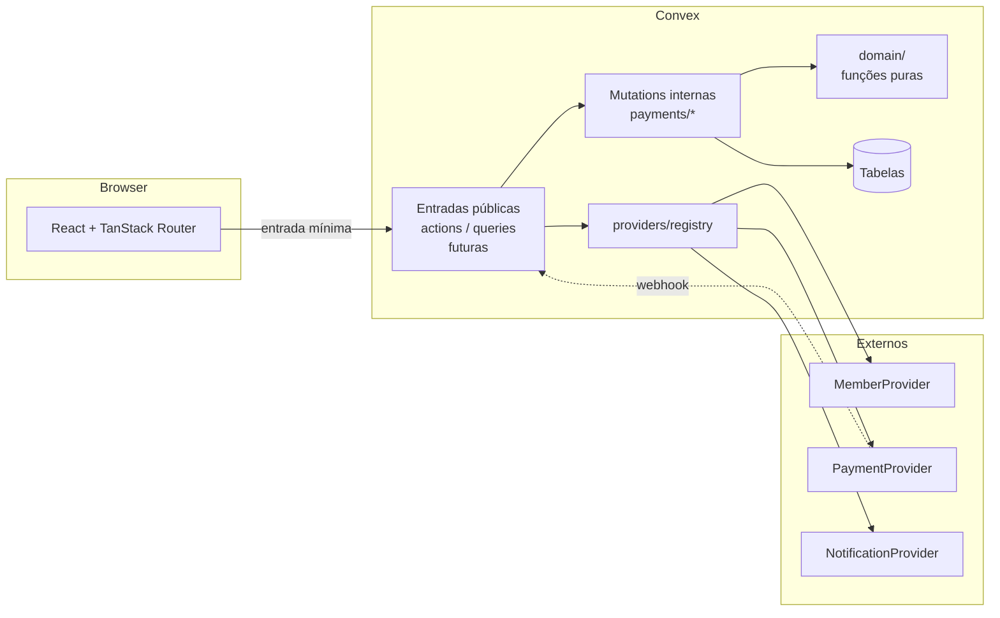
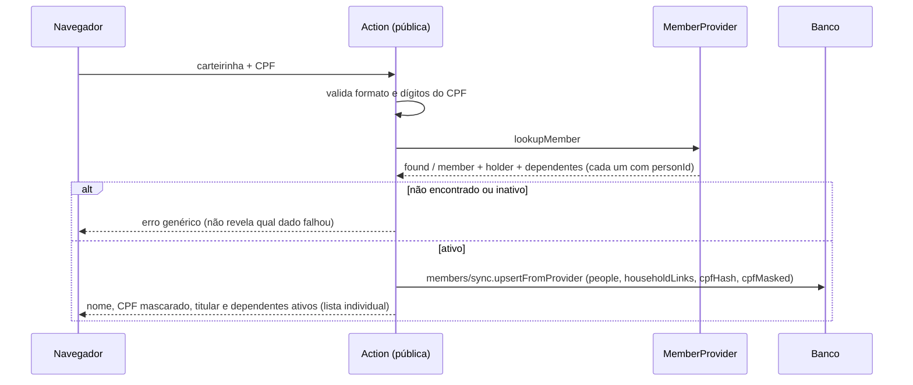

# Arquitetura

Aplicação pública (sem contas de associados) para pagamento da taxa médica das piscinas da sede
campestre: R$ 30,00 por pessoa, via Pix ou cartão, com 15 minutos para concluir.

> Escopo: **não** é um sistema de reservas. Não há agenda, disponibilidade, lotação nem outros
> espaços. Regras em [business-rules.md](./business-rules.md).

## Camadas



| Camada                | Local                                                       | Responsabilidade                                                                                             |
| --------------------- | ----------------------------------------------------------- | ------------------------------------------------------------------------------------------------------------ |
| Interface             | `src/`                                                      | Exibir dados e coletar entradas. Não calcula valores nem decide elegibilidade.                               |
| Entradas públicas     | `convex/members`, `convex/payments`, `convex/notifications` | **Ainda não implementadas.** Actions que falam com providers e chamam as mutations internas.                 |
| Mutations internas    | `convex/payments/`                                          | Consistência e regras que exigem transação: criar operação, expirar, aplicar confirmação, concluir análise.  |
| Domínio               | `convex/domain/`                                            | Funções puras e testáveis: decisão de confirmação, seleção, política de uso, preço, estados, mensagens, CPF. |
| Contratos e providers | `convex/providers/`                                         | Interfaces, mocks e `registry.ts`.                                                                           |
| Dados                 | `convex/schema.ts`                                          | Ver [data-model.md](./data-model.md).                                                                        |

**Funções internas por padrão.** Tudo em `convex/payments/` é `internalMutation`: não é
alcançável pelo navegador. A superfície pública será criada depois, por actions que antes
validam identidade (carteirinha + CPF) no `MemberProvider`.

**Núcleo puro + execução transacional.** Decisões complexas (ex.: `decideConfirmation`,
`resolveSelection`) são funções puras sem acesso a banco, testadas isoladamente. As mutations
apenas carregam dados, chamam a decisão e a executam de forma atômica.

## Estrutura do backend

```text
convex/
  schema.ts
  domain/
    statuses.ts       enums, validators, máquinas de estado
    pricing.ts        taxa, prazo de 15 min, cálculo de totais
    time.ts           datas de calendário x instantes, fuso America/Sao_Paulo
    usagePolicy.ts    regras de uso configuráveis (data, valor unitário)
    selection.ts      seleção individual por vínculo; duplicidade por personId
    confirmation.ts   decisão sobre notificações de pagamento
    messages.ts       textos exibidos ao associado
    cpf.ts, privacy.ts
  members/
    sync.ts           upsert de titular, pessoas (personId) e vínculos
  payments/
    operations.ts     create, expire
    confirmations.ts  applyConfirmation (helper; só chamado por providerEvents)
    providerEvents.ts ingest (porta única de eventos do provedor), resolveAlert
    reviews.ts        resolve (análise administrativa)
    claims.ts         reservas por pessoa/data (duplicidade)
    events.ts         histórico de alterações
    receipts.ts       emissão idempotente e numeração
  providers/          contratos, registry e mock/
tests/                domain/ (puros) e convex/ (convex-test)
```

## Fluxos

### 1. Identificação do associado (futuro)



O titular e cada dependente são devolvidos como itens separados (cada um é um vínculo, com
`personId` próprio); o titular é opcional. Identidade, vínculo e papel são coisas distintas: ver
[data-model.md](./data-model.md#identidade-vínculo-e-papel).

### 2. Criação da operação

1. O navegador envia **carteirinha, CPF, data e as pessoas escolhidas** (referências). Nunca
   valores, nomes ou prazos.
2. A action revalida o associado e chama `internal.payments.operations.create`.
3. Em **uma única transação**, a mutation: valida a data (não passada no calendário de São
   Paulo), carrega titular e vínculos do banco, resolve a seleção (`resolveSelection`),
   **verifica duplicidade** por `personId` e data (global, entre titulares), calcula valores (`UsagePolicy` + `calculateOperationAmounts`), grava operação,
   pessoas e reservas, registra o evento `created` e agenda a expiração.
4. Retorna `operationId` + `accessToken` (só o hash é guardado) + valores calculados.

### 3. Cobrança (futuro)

A action lê o valor **da operação** e chama `PaymentProvider.createPixCharge` /
`createCardCharge` com `idempotencyKey`; registra a transação como `pending`. Cartão usa token do
SDK do provedor: nenhum dado de cartão chega ao backend.

### 4. Confirmação

```mermaid
sequenceDiagram
  participant P as Provedor
  participant H as HTTP action (futura)
  participant PP as PaymentProvider
  participant I as providerEvents.ingest
  P->>H: POST webhook (corpo bruto + assinatura)
  H->>PP: processConfirmation
  PP-->>H: PaymentConfirmation (ou invalid_signature)
  H->>I: provider, eventId, transação, status, valor, occurredAt
  I->>I: registra o evento (providerEvents)
  alt mesmo evento já recebido
    I-->>H: duplicate (não reaplica)
  else cobrança desconhecida
    I-->>H: unknown_transaction (alerta administrativo; nada confirmado)
  else transação nossa
    I->>I: applyConfirmation → decideConfirmation (função pura)
    I-->>H: ignored / transaction_updated / confirmed / under_review
  end
  H->>H: agenda notificações conforme o resultado
```

O registro do evento e o processamento ocorrem na **mesma transação**. Detalhes, tabela de
cenários e tratamento de eventos desconhecidos em
[business-rules.md](./business-rules.md#tratamento-de-pagamentos-e-confirmações).

### 5. Notificações (parcialmente futuro)

Uma action por canal e por tipo, independentes entre si:

- `confirmed` → comprovante por e-mail e WhatsApp (`kind: receipt`).
- `under_review` → atualização por e-mail e WhatsApp (`kind: payment_under_review`) com a
  mensagem de `domain/messages.ts` (`LATE_PAYMENT_MESSAGE` quando o motivo é atraso).
- Conclusão da análise: também deverá notificar o associado (texto a definir com o sindicato).

Cada tentativa gera uma linha em `notifications`. O destino real é lido do titular no momento
do envio. Contratos já existem (`sendReceipt*`, `sendPaymentUpdate*`); as actions de envio serão
implementadas junto com as integrações.

## Decisões arquiteturais

1. **Backend é a única autoridade financeira.** Valor, quantidade, prazo e elegibilidade são
   calculados e validados no Convex.
2. **Providers por interface + registry.** Regras de negócio dependem só das interfaces.
3. **Seguro por padrão.** Mocks só funcionam com `APP_ENV=development`.
4. **Duplicidade garantida dentro da transação** (verificação e inserção na mesma mutation,
   índice de reservas ativas), apoiada na serialização do Convex. Ver
   [business-rules.md](./business-rules.md#prevenção-de-duplicidade).
5. **Dois eixos de estado** (financeiro e operacional).
6. **Dinheiro recebido nunca é descartado.** Qualquer recebimento fora do caminho feliz vai para
   análise administrativa; sem liberação automática e sem reembolso automático.
7. **"No prazo" pelo instante do recebimento** (`occurredAt`), não pela chegada da notificação.
8. **Regras pendentes isoladas em `UsagePolicy`.** Dias, horários, antecedência, isenções e
   faixas etárias entram trocando a implementação, sem tocar nas mutations.
9. **Núcleo de decisão puro** (`decideConfirmation`, `resolveSelection`, `time.ts`): testável sem banco.
10. **Funções `internal` por padrão**; a superfície pública virá por actions validadas.
11. **Sem sessão de associado.** Cada operação sensível reautentica com carteirinha + CPF.
12. **Credencial por operação (`accessToken`)** para acompanhar status sem expor terceiros.
13. **CPF nunca em claro** (HMAC + máscara); erros de identificação genéricos.
14. **Dinheiro em centavos inteiros.**
15. **Node 22 padronizado** (`.nvmrc`, `engines`): o CLI do Convex, o Vitest 5 e o ESLint 10
    exigem 22+. Nomes de arquivo em `convex/` em camelCase.
16. **Identidade ≠ vínculo ≠ papel.** `personId` identifica a pessoa; o vínculo liga a um titular;
    o papel descreve a relação. A duplicidade usa `personId`.
17. **Instantes em UTC, datas em calendário.** Uma única ponte explícita (`businessCalendarDate`)
    para o fuso de São Paulo. Ver [data-model.md](./data-model.md#datas-e-fuso-horário).
18. **Todo evento do provedor é registrado antes de ser decidido.** Cobrança desconhecida gera
    alerta e nunca confirma nem libera nada.

## Ambiente

Node **22** (`.nvmrc` = `22`; `engines`: `^22.13.0 || ^24.0.0 || >=26.0.0`, a interseção das
exigências de Convex, Vite, Vitest e ESLint). Com Node 20 o `pnpm` avisa e o Vitest 5 falha ao
reportar erros (`Map.groupBy`). Gerenciador: pnpm. Nenhuma dependência foi adicionada para
padronizar o ambiente; foi removida uma dependência acidental (`cn`).

## Testes

Vitest (`pnpm test`). `tests/domain/` roda em Node e cobre as funções puras;
`tests/convex/` usa `convex-test` (ambiente `edge-runtime`) para exercitar as mutations reais
com um banco em memória, usando apenas dados fictícios. `convex-test` valida a lógica, mas
**não simula o controle otimista de concorrência** do Convex; essa garantia foi verificada
manualmente contra um backend local (ver business-rules.md).

## Segurança

- Identificação exige carteirinha **e** CPF; sem listagem nem busca parcial.
- Respostas não distinguem carteirinha inexistente de CPF incorreto.
- CPF completo não é persistido nem devolvido; apenas `cpfMasked`.
- Nenhum dado clínico.
- Dados financeiros só são acessíveis com `operationId` + `accessToken`.
- O navegador não envia valores; argumentos desconhecidos são rejeitados pelos validators.
- Logs não devem conter CPF, e-mail ou telefone.
- **Administração (futuro):** `paymentReviews.resolve` já existe como função interna. O painel a
  exporá por um wrapper único (`adminQuery`/`adminMutation`) que exige identidade autenticada e
  papel; `resolvedBy` receberá a identidade. Falta escolher o provedor de autenticação.
- **Abuso na identificação:** rate limiting e/ou CAPTCHA ainda não definidos.

## Dependências de integrações futuras

| Ponto                       | Depende de                                                                                                   |
| --------------------------- | ------------------------------------------------------------------------------------------------------------ |
| `MemberProvider` real       | Acesso ao cadastro do sindicato; **identificador estável e único de pessoa** (`personId`)                    |
| `PaymentProvider` real      | Conta e chaves do provedor (Stripe), webhook público                                                         |
| Registro da transação       | Garantir que toda cobrança criada no provedor tenha linha local (webhook de cobrança desconhecida só alerta) |
| `NotificationProvider` real | Provedor de e-mail e WhatsApp Business (templates aprovados)                                                 |
| Comprovante em PDF          | Layout e dados oficiais do sindicato                                                                         |
| Painel administrativo       | Autenticação; consome `paymentReviews.by_status` e `providerEvents.by_alert_status`                          |
| Regras de uso               | Dias, horários, antecedência, isenções, faixas etárias                                                       |
| Proteção contra abuso       | Rate limiting e/ou CAPTCHA                                                                                   |

Detalhes dos contratos em [integrations.md](./integrations.md).
