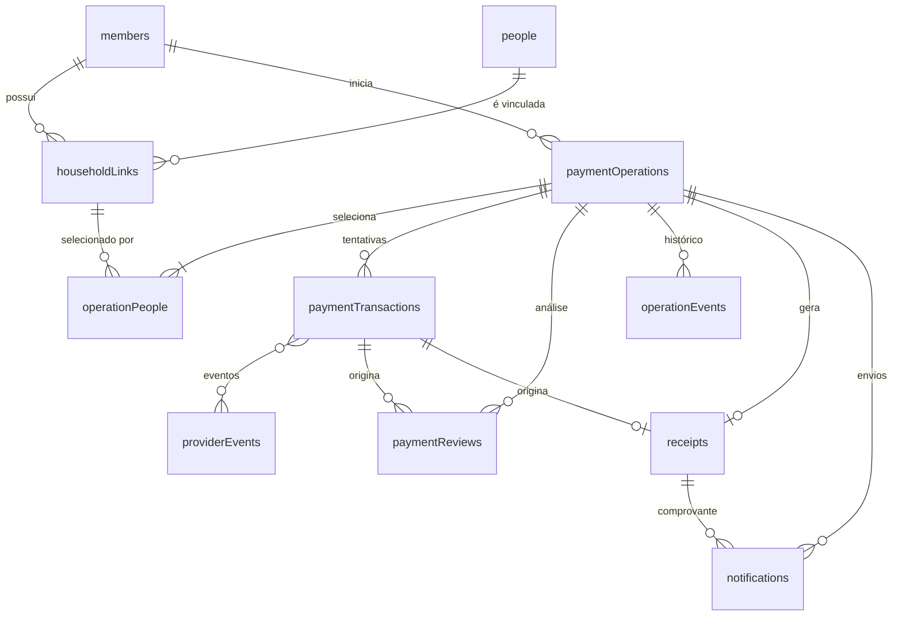
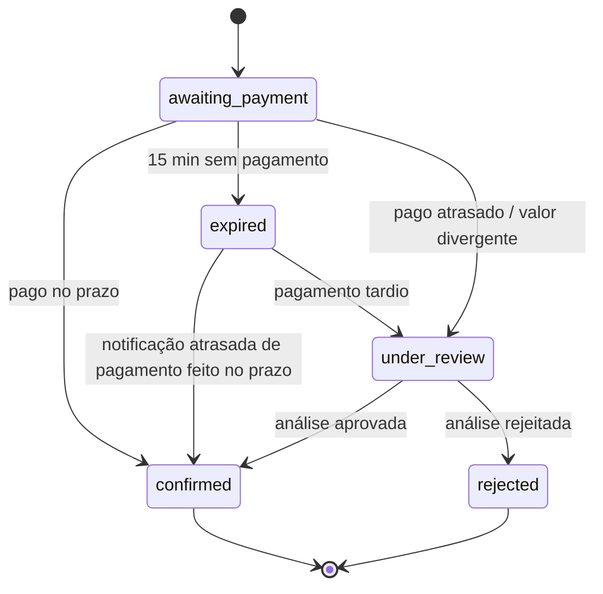

# Modelo de dados

Schema em [`convex/schema.ts`](../convex/schema.ts). Enums e tipos em
[`convex/domain/statuses.ts`](../convex/domain/statuses.ts) (fonte única: validators do Convex
alimentam o schema e, via `Infer`, os tipos TypeScript). Regras de negócio em
[business-rules.md](./business-rules.md).

## Convenções

| Tema           | Decisão                                                                       |
| -------------- | ----------------------------------------------------------------------------- |
| Dinheiro       | Inteiros em centavos (BRL), campos com sufixo `Cents`. Nunca ponto flutuante. |
| Instantes      | Milissegundos desde a época Unix (`number`), sempre UTC. Nunca texto.         |
| `createdAt`    | Usa o `_creationTime` nativo do Convex. Não há campo duplicado.               |
| `updatedAt`    | Explícito apenas em tabelas cujas linhas mudam.                               |
| Datas civis    | `usageDate` é string `YYYY-MM-DD`, sem hora e sem fuso, nunca convertida.     |
| Fuso           | `America/Sao_Paulo`, só para saber "que dia é hoje". Ver seção abaixo.        |
| Exclusão       | Nada é apagado. Histórico = linhas imutáveis + `operationEvents`.             |
| Dados clínicos | Não existem no modelo. "Taxa médica" é apenas o nome da taxa.                 |

## Datas e fuso horário

Há dois conceitos, nunca misturados (implementação em
[`convex/domain/time.ts`](../convex/domain/time.ts)):

| Conceito               | Tipo                             | Exemplos                                                          | Fuso                  |
| ---------------------- | -------------------------------- | ----------------------------------------------------------------- | --------------------- |
| **Instante**           | `number` (ms desde a época, UTC) | `_creationTime`, `expiresAt`, `paidAt`, `occurredAt`, `updatedAt` | UTC por definição     |
| **Data de calendário** | string `YYYY-MM-DD`              | `usageDate`                                                       | Nenhum (é o "dia 10") |

- O prazo de 15 minutos é aritmética sobre instantes: não depende de fuso, meia-noite ou
  horário de verão.
- A **única** ponte entre os dois é `businessCalendarDate(instante)`: "que dia é este instante
  no calendário de São Paulo?". Usada para (a) bloquear datas anteriores a hoje e (b) o ano do
  número do comprovante. Resolvida com a base IANA do runtime (`Intl`, `timeZone` explícito,
  calendário gregoriano e dígitos latinos fixados), nunca com `-3h` fixo, nem com o fuso do
  servidor ou do navegador.
- Proibido no backend: `getFullYear()/getDate()/getHours()` e `toLocaleDateString()` sem fuso,
  `new Date('YYYY-MM-DD')` para datas de uso.
- Instante inválido (`NaN`, infinito) ou fuso desconhecido **lançam erro**, em vez de produzir
  uma data errada.
- Verificado no runtime real do Convex (backend local), além dos testes: `Intl` com `timeZone`
  funciona lá. Meia-noite local: `2026-12-01T03:00:00Z` (UTC-3) é o primeiro instante do dia
  `2026-12-01`.
- O navegador (futuro) deve enviar `usageDate` como o dia escolhido no calendário, sem
  convertê-lo para instante e de volta.

## Identidade, vínculo e papel

Três coisas diferentes, em três lugares:

| Conceito                   | Onde                  | Observação                                                                           |
| -------------------------- | --------------------- | ------------------------------------------------------------------------------------ |
| **Quem é a pessoa**        | `people.personId`     | Identificador **estável e único** da pessoa. Uma linha por pessoa, nome atual.       |
| **Ligação com um titular** | `householdLinks`      | Uma linha por (titular, vínculo de origem). A mesma pessoa pode ter vários vínculos. |
| **Papel na família**       | `householdLinks.role` | `holder`, `spouse`, `child`, `parent`, `other`. Muda sem mudar a identidade.         |

O titular também é uma pessoa: tem um vínculo com papel `holder` (`externalLinkId = "holder"`).
Assim a seleção é uniforme (só vínculos) e o titular continua opcional.

`personId` **não é** o id do vínculo nem do titular. É a base da prevenção global de
duplicidade (`operationPeople.personId`): "Clara, filha de dois titulares" é uma pessoa, dois
vínculos, e só pode ser cobrada uma vez por data.

**Limitação (pendente):** o sistema é tão confiável quanto o `personId` recebido. O cadastro
oficial do sindicato precisa fornecer um identificador estável por pessoa (ex.: id interno de
cadastro). Se só existirem ids por vínculo ou nomes, a duplicidade **entre titulares
diferentes não pode ser garantida**; só a duplicidade dentro do mesmo titular continuaria
protegida. Não foi usado CPF de dependente nem nome+nascimento como substituto: seriam dados
pessoais adicionais e/ou ambíguos (homônimos). Os mocks usam `mock-person-NNNN`.

## Relacionamentos

## Alterações desta revisão

| Mudança                                                              | Justificativa                                                                                                                                   |
| -------------------------------------------------------------------- | ----------------------------------------------------------------------------------------------------------------------------------------------- |
| `paymentOperations.status` → `financialStatus` + `operationalStatus` | Um único campo não distingue "recebi o dinheiro" de "posso liberar o uso". Pagamento tardio exige os dois eixos (ver abaixo).                   |
| Removido `paymentOperations.selectedPeople` (array)                  | Arrays não são indexáveis. A seleção virou a tabela `operationPeople`, que também sustenta a prevenção de duplicidade. Nenhum dado foi perdido. |
| Novo `operationPeople`                                               | Seleção individual, snapshot de nomes e reserva por pessoa/data.                                                                                |
| Novo `paymentReviews`                                                | Fila de análise administrativa de recebimentos que não podem ser liberados automaticamente.                                                     |
| Novo `operationEvents`                                               | "Histórico de alterações": registro append-only dos estados resultantes de cada mudança.                                                        |
| `notifications.receiptId` opcional + novo `kind`                     | Atualizações sobre análise (sem comprovante) também são notificadas por e-mail e WhatsApp.                                                      |
| Removido o estado `canceled`                                         | Não há fluxo de cancelamento definido; reintroduzir quando existir, com a transição correspondente.                                             |

### Revisão técnica (Prompt 04)

| Mudança                                                                          | Justificativa                                                                                            |
| -------------------------------------------------------------------------------- | -------------------------------------------------------------------------------------------------------- |
| Nova tabela `people` (`personId`)                                                | Separa a identidade da pessoa do vínculo familiar e do papel.                                            |
| `dependents` → `householdLinks` (vínculo + papel + situação)                     | O vínculo passa a ser uma ligação (titular, pessoa); o titular também tem vínculo (`holder`).            |
| `members.name` removido                                                          | O nome pertence à pessoa; evita duas fontes para o mesmo dado.                                           |
| `operationPeople`: `personKey/kind/dependentId` → `personId/linkId/role`         | A duplicidade global usa o id da pessoa, não um id local do titular.                                     |
| Nova tabela `providerEvents`                                                     | Registro de todo evento recebido do provedor: repetição, transação desconhecida e alerta administrativo. |
| `confirmations.apply` (mutation) → `applyConfirmation` + `providerEvents.ingest` | Toda notificação passa por uma porta única que registra antes de decidir.                                |
| Datas: lógica isolada em `domain/time.ts`                                        | Estratégia de fuso documentada e testada; `todayInTimeZone` virou `businessCalendarDate`.                |
| Códigos de erro `dependent_not_found/inactive` → `link_not_found/inactive`       | Consequência da troca de modelo; mesma regra (vínculo inexistente ou inativo é recusado).                |

### Telas da jornada (frontend)

As quatro primeiras telas usam as funções públicas existentes. A etapa 4 **cria** a operação
(`payments:createOperation`) e passou a preencher `requestKeyHash` (opcional) + índice
`by_member_request` para idempotência. Seleção e data **só** viram dado persistido na criação.
O navegador identifica pessoas por `linkId`, nunca por `personId`. A data é `YYYY-MM-DD` sem
conversão. Nada da jornada (nem `accessToken`) vai para `localStorage` / `sessionStorage` /
cookie / URL. Ver [business-rules.md](./business-rules.md#resumo-e-criação-da-operação).

## Estado financeiro × estado operacional

São dois eixos independentes na mesma operação:

- **Financeiro (`financialStatus`)**: _o dinheiro foi recebido?_ Descreve apenas o recebimento.
  `unpaid` (nada válido recebido), `paid` (recebido no prazo), `paid_late` (recebido depois do
  prazo).
- **Operacional (`operationalStatus`)**: _o direito de uso pode ser exercido?_ Descreve o que o
  sistema e a equipe fazem com a operação. `awaiting_payment`, `confirmed` (utilização
  liberada), `expired`, `under_review`, `rejected`.

Um pagamento tardio mostra por que são dois eixos: o financeiro diz `paid_late` (o dinheiro
**existe**), enquanto o operacional diz `under_review` (a utilização **ainda não** está liberada).

| `financialStatus` | `operationalStatus` | Situação                                                                                |
| ----------------- | ------------------- | --------------------------------------------------------------------------------------- |
| `unpaid`          | `awaiting_payment`  | Aberta, dentro do prazo.                                                                |
| `unpaid`          | `expired`           | Prazo encerrado sem recebimento.                                                        |
| `paid`            | `confirmed`         | Recebido no prazo; utilização liberada; comprovante emitido.                            |
| `paid_late`       | `under_review`      | Recebido após o prazo; aguarda análise administrativa.                                  |
| `paid_late`       | `confirmed`         | Análise aprovada pelo administrador; comprovante emitido.                               |
| `paid_late`       | `rejected`          | Análise concluiu que a utilização não será liberada.                                    |
| `unpaid`          | `under_review`      | Valor recebido diferente do esperado (`amount_mismatch`).                               |
| `paid`            | `under_review`      | Recebido no prazo, mas a pessoa já foi reservada por outra operação (`claim_conflict`). |

Transições permitidas (`canTransitionOperational`, `canTransitionFinancial`):

Financeiro: `unpaid → paid | paid_late`; `paid` e `paid_late` são finais.

## Tabelas

### `members`, `people` e `householdLinks`

`members` é um cache do cadastro (fonte da verdade: `MemberProvider`); o CPF é guardado apenas
como HMAC (`cpfHash`) e máscara (`cpfMasked`). Não tem nome: o nome do titular está em `people`.

`people`: `personId`, `name`, `updatedAt`. Uma linha por pessoa, compartilhada por todos os
titulares que a incluem.

`householdLinks`: `memberId`, `personRef` (→ `people`), `externalLinkId` (id do vínculo na
origem; `"holder"` é reservado ao titular), `role`, `status` (`active`/`inactive`).

A sincronização (`members/sync:upsertFromProvider`, interna) é idempotente: mantém `personId` e
ids de vínculo, atualiza nomes/papéis e marca como `inactive` os vínculos que sumiram do
cadastro (nada é apagado). Recusa `personId` vazio e `externalLinkId` repetido.

Índices: `members.by_membership_number`, `members.by_cpf_hash`, `people.by_person_id`,
`householdLinks.by_member_and_external_link` (atende também "vínculos por titular", pelo
prefixo).

### `paymentOperations`

| Campo                                  | Observação                                                                             |
| -------------------------------------- | -------------------------------------------------------------------------------------- |
| `memberId`                             | Titular que iniciou a operação.                                                        |
| `usageDate`                            | `YYYY-MM-DD`, obrigatória, nunca no passado.                                           |
| `quantity`                             | Número de pessoas (= linhas de `operationPeople`).                                     |
| `unitAmountCents`, `totalAmountCents`  | Calculados no backend: `total = quantity × unit`. Padrão: 3000 por pessoa.             |
| `expiresAt`                            | `createdAt + 15 min`.                                                                  |
| `financialStatus`, `operationalStatus` | Ver acima.                                                                             |
| `paidAt`                               | Instante do recebimento informado pelo provedor (`occurredAt`).                        |
| `accessTokenHash`                      | SHA-256 do token entregue ao navegador (nunca o token em claro).                       |
| `requestKeyHash` (opcional)            | SHA-256 de `memberId` + `requestId` (idempotência). Ausente se criado sem `requestId`. |
| `updatedAt`                            |                                                                                        |

Índices: `by_member`; `by_member_request` (`memberId`, `requestKeyHash`) — localiza a operação
da mesma solicitação para devolvê-la na repetição, na mesma transação da criação.

### `operationPeople`

Uma linha por pessoa selecionada.

| Campo         | Observação                                                                  |
| ------------- | --------------------------------------------------------------------------- |
| `operationId` |                                                                             |
| `usageDate`   | Cópia da data da operação (necessária para o índice).                       |
| `personId`    | Identificador estável da **pessoa** (não do vínculo). Chave da duplicidade. |
| `linkId`      | Vínculo pelo qual foi selecionada (contexto de qual titular).               |
| `role`        | Papel no momento da operação (snapshot).                                    |
| `name`        | Snapshot do nome.                                                           |
| `claim`       | `active` enquanto a operação bloqueia novas cobranças; `released` depois.   |

Índices: `by_operation`; `by_person_date_claim [personId, usageDate, claim]` (prevenção de
duplicidade global, entre titulares).

Ciclo de vida da reserva (`claim`):

| Evento                                   | `claim`                                    |
| ---------------------------------------- | ------------------------------------------ |
| Operação criada                          | `active`                                   |
| Pago (no prazo ou aprovado após análise) | permanece `active`                         |
| Pagamento tardio / divergente em análise | `active` (retomada se havia sido liberada) |
| Expirou sem recebimento                  | `released`                                 |
| Análise rejeitada                        | `released`                                 |

### `paymentTransactions`

Tentativas junto ao provedor (uma cobrança = uma linha). Índices `by_operation` e
`by_provider_transaction [provider, providerTransactionId]` (webhook idempotente).
`succeeded` é terminal (`canTransitionTransaction`). Nasce sempre `pending`; o resultado imediato
do provedor é aplicado por `ingestProviderEvent`. Novos campos opcionais: `qrCode`
(`{ kind: 'placeholder' | 'image_url', value }`, Pix) e `chargeExpiresAt` (limite do Pix segundo o
provedor). Nunca guarda token nem dado de cartão.

### `chargeAttempts`

Tentativa de **criar** uma cobrança no provedor, gravada **antes** da chamada externa. É o ponto de
exclusão entre chamadas simultâneas e a base da idempotência. Campos: `operationId`, `method`,
`attempt` (1, 2, 3), `idempotencyKey` (`op_<operationId>_<forma>_<n>`), `state`
(`creating | created | error`), `startedAt`, `transactionId?` e `errorCode?` (só o código técnico).
Índice: `by_operation`. Máximo de 3 por operação. `creating` há mais de 60 s é considerada
interrompida e é retomada com a mesma chave. Não guarda token de cartão.

### `providerEvents`

Registro de **todo** evento financeiro recebido do provedor, conhecido ou não. Guarda só
campos normalizados e não pessoais (o corpo bruto não é persistido).

| Campo                                                          | Observação                                                                            |
| -------------------------------------------------------------- | ------------------------------------------------------------------------------------- |
| `provider`, `eventId`                                          | Origem + identificador do evento: identidade do evento (detecta repetição).           |
| `providerTransactionId`, `status`, `amountCents`, `occurredAt` | Conteúdo normalizado do evento (`occurredAt` em UTC).                                 |
| `occurrences`, `lastReceivedAt`                                | Quantas vezes chegou (>1 = repetido) e quando foi a última. A 1ª é o `_creationTime`. |
| `outcome`                                                      | `confirmed`, `under_review`, `ignored`, `transaction_updated`, `unknown_transaction`. |
| `operationId`                                                  | Preenchido quando o evento correspondeu a uma transação nossa.                        |
| `alertReason`, `alertStatus`                                   | `unknown_transaction` + `open`/`resolved`, quando exige análise humana.               |
| `resolvedAt`, `resolvedBy`, `resolutionNote`                   | Preenchidos ao encerrar o alerta (por humano ou pelo sistema).                        |

Índices: `by_provider_event [provider, eventId]` (repetição); `by_alert_status` (fila de
alertas do painel administrativo).

### `paymentReviews`

| Campo                                        | Observação                                                                    |
| -------------------------------------------- | ----------------------------------------------------------------------------- |
| `operationId`, `transactionId`               | Operação e transação que originaram a análise.                                |
| `reason`                                     | `late_payment`, `amount_mismatch`, `unexpected_payment`, `claim_conflict`.    |
| `status`                                     | `open`, `approved`, `rejected`.                                               |
| `resolvedAt`, `resolvedBy`, `resolutionNote` | Preenchidos ao concluir. `resolvedBy` receberá a identidade do administrador. |

Índices: `by_operation`; `by_status` (fila de pendências do painel administrativo).

### `operationEvents`

Append-only. Cada linha guarda `type` (`created`, `expired`, `payment_confirmed`,
`review_opened`, `review_resolved`), `actor` (`member`, `system`, `provider`, `admin`), os
estados **resultantes** (`financialStatus`, `operationalStatus`) e `note` opcional (motivo).
A data do evento é o `_creationTime`. Índice: `by_operation`.

### `receipts`

Inalterada. Emitida na confirmação no prazo ou na aprovação de uma análise. Idempotente: no
máximo um comprovante por operação. Numeração `SC-AAAA-NNNNNN` (prefixo provisório).

### `notifications`

Uma linha por tentativa de envio. Novo campo `kind`: `receipt` (com `receiptId`) ou
`payment_under_review` (sem `receiptId`). Índice: `by_operation`.

### `identificationSessions`

Prova de identificação emitida pela consulta cadastral. Campos: `memberId`, `tokenHash` (SHA-256
do token aleatório de 256 bits; o token só existe na resposta), `expiresAt` (30 min). Não guarda
CPF. Removida por função agendada ao expirar. Índice: `by_token_hash`.

### `rateLimits`

Contadores de janela fixa para proteção técnica contra abuso: `key` (`lookup:fail:<carteirinha>`,
`lookup:global`, `create:<memberId>`), `count`, `expiresAt`. Não são regras de negócio. Removida
por função agendada ao expirar. Índice: `by_key`.

## Índices

| Consulta                          | Índice                                                 | Observação                              |
| --------------------------------- | ------------------------------------------------------ | --------------------------------------- |
| Associado por carteirinha         | `members.by_membership_number`                         |                                         |
| Associado por CPF                 | `members.by_cpf_hash`                                  | Busca pelo HMAC do CPF.                 |
| Pessoa por `personId`             | `people.by_person_id`                                  | Nova.                                   |
| Vínculos por titular              | `householdLinks.by_member_and_external_link` (prefixo) | Substitui `dependents.*`.               |
| Evento do provedor por origem/id  | `providerEvents.by_provider_event`                     | Nova. Repetição de eventos.             |
| Alertas abertos                   | `providerEvents.by_alert_status`                       | Nova. Painel administrativo.            |
| Pagamentos por associado          | `paymentOperations.by_member`                          |                                         |
| Pessoas de uma operação           | `operationPeople.by_operation`                         | Nova.                                   |
| **Reserva ativa por pessoa/data** | `operationPeople.by_person_date_claim`                 | Nova. Base da prevenção de duplicidade. |
| Transações por operação           | `paymentTransactions.by_operation`                     |                                         |
| Webhook do provedor               | `paymentTransactions.by_provider_transaction`          | Idempotência.                           |
| Análises de uma operação          | `paymentReviews.by_operation`                          | Nova.                                   |
| Fila de análises abertas          | `paymentReviews.by_status`                             | Nova. Painel administrativo.            |
| Histórico de uma operação         | `operationEvents.by_operation`                         | Nova.                                   |
| Comprovante da operação / número  | `receipts.by_operation`, `receipts.by_receipt_number`  |                                         |
| Notificações por operação         | `notifications.by_operation`                           |                                         |
| Tentativas de cobrança            | `chargeAttempts.by_operation`                          | Nova. Exclusão e idempotência.          |
| Prova de identificação            | `identificationSessions.by_token_hash`                 | Nova (API pública).                     |
| Contador de limite                | `rateLimits.by_key`                                    | Nova (API pública).                     |

Não há índice por `expiresAt`: a expiração é uma função agendada por operação.

## Decisões e justificativas

1. **Dois eixos de estado** em vez de um enum combinado: evita explosão de valores e deixa
   explícito que "recebido" e "liberado" são perguntas diferentes.
2. **`operationPeople` como fonte da reserva.** A unicidade por pessoa/data é garantida por uma
   consulta de índice dentro da mesma transação que insere a reserva (ver
   [business-rules.md](./business-rules.md#prevenção-de-duplicidade)).
3. **Revisão (`paymentReviews`) separada da operação.** Uma operação pode receber um segundo
   pagamento depois de já resolvida; a análise precisa existir sem alterar o estado da operação.
4. **Instante do recebimento (`occurredAt`) decide "no prazo".** Não o instante em que a
   notificação chegou, para não punir o associado por atraso de webhook.
5. **CPF como HMAC**, **`accessTokenHash`**, **snapshot de nomes**, **`recipientMasked`**,
   **`createdAt` nativo**: mantidos da revisão anterior.
6. **Valor unitário único por operação.** Se surgirem preços por faixa etária, cada
   `operationPeople` ganhará `amountCents` e o total passará a ser a soma. Não foi antecipado
   porque as regras ainda não existem.

## Pontos em aberto

- **Identificador oficial de pessoa:** o modelo já usa `personId`, mas o cadastro oficial
  precisa fornecê-lo (estável, único por pessoa, independente do vínculo). Sem isso, a
  duplicidade entre titulares diferentes não é garantida. Ver
  [Identidade, vínculo e papel](#identidade-vínculo-e-papel).
- **Alertas de eventos desconhecidos** não têm interface nem autenticação administrativa ainda
  (`resolveAlert`/`listOpenAlerts` são internas).
- **Corpo bruto de webhooks** não é guardado; se for necessário para auditoria, definir retenção
  (LGPD) antes.
- **Regras de funcionamento, antecedência, isenções e faixas etárias:** ver
  [business-rules.md](./business-rules.md#regras-pendentes).
- **Outras situações cadastrais**, além de `active`/`inactive`.
- **Retenção de dados** (LGPD).
